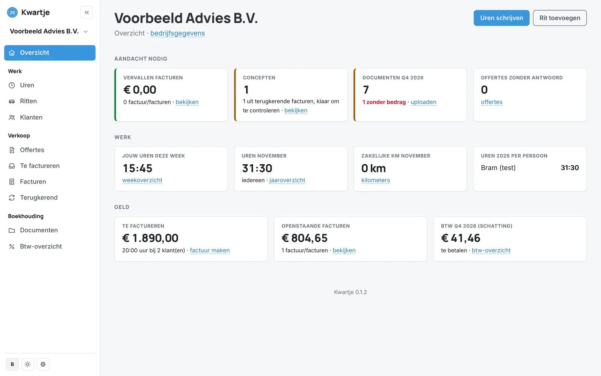
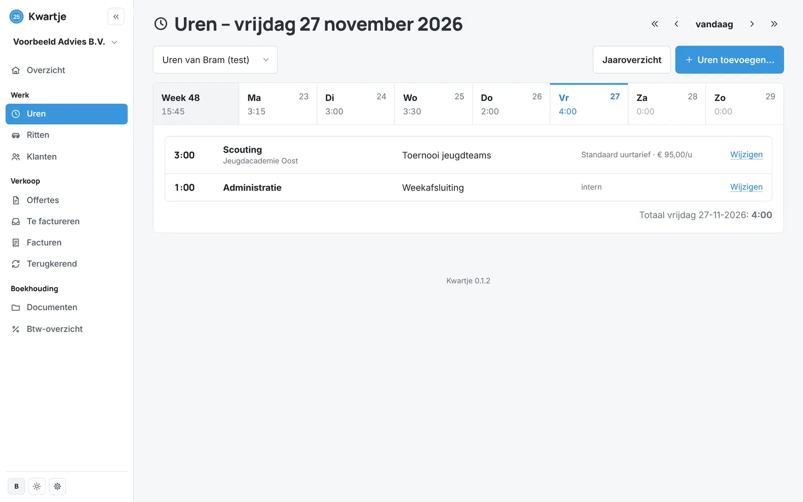
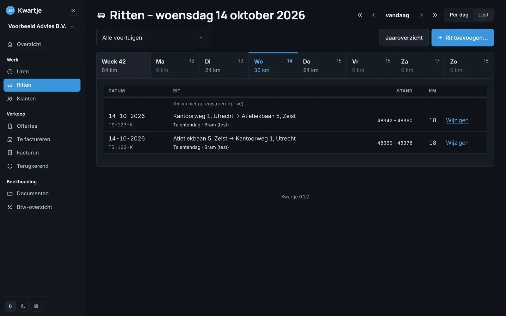
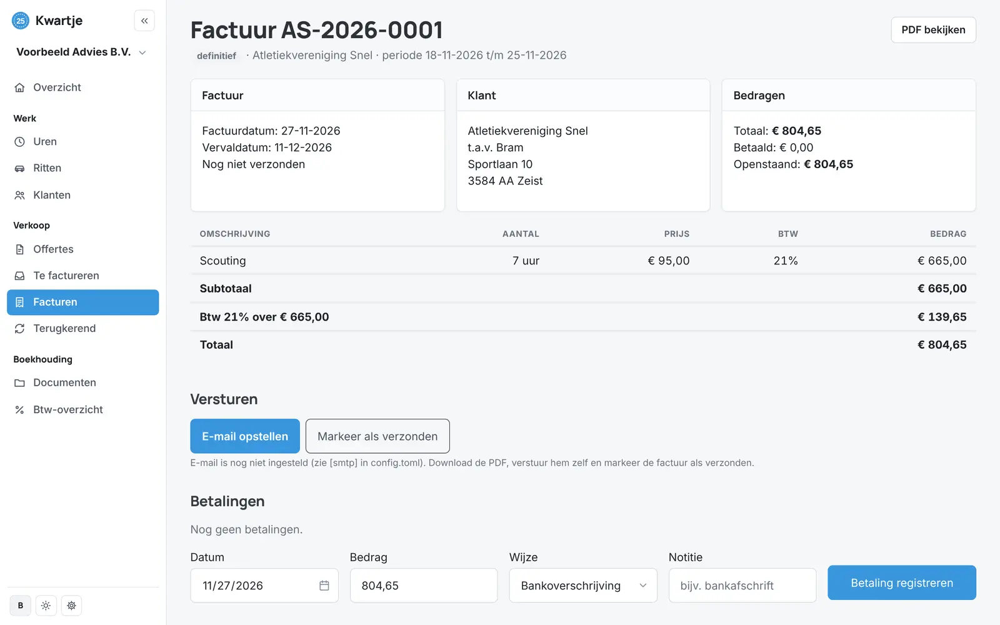
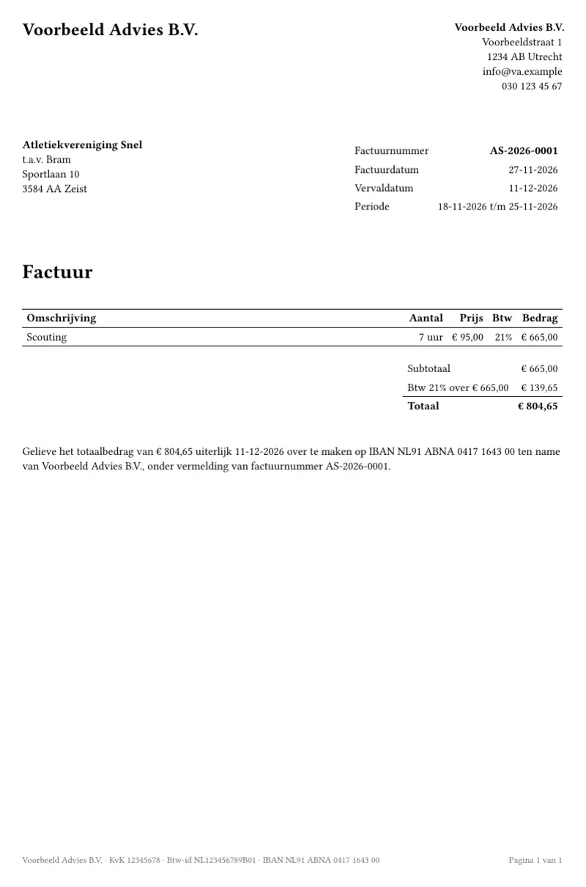
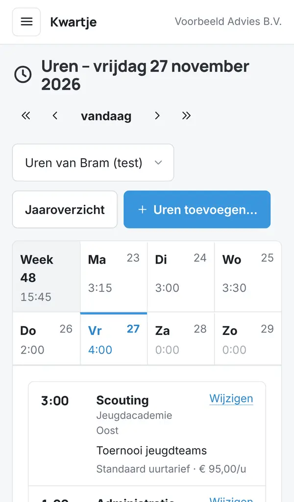

<div align="center">


# Kwartje

**Hours, trips and invoices for small Dutch businesses.**<br>
Self-hosted, private, and made to work next to your accountant.

[](https://github.com/KJELD-LRNT/kwartje/actions/workflows/ci.yml)
[](https://github.com/KJELD-LRNT/kwartje/releases/latest)
[](LICENSE)
[](https://www.rust-lang.org)
[](#a-dutch-app)

[Features](#features) · [Screenshots](#screenshots) · [Get started](#get-started) · [Documentation](#documentation) · [Contributing](#contributing)

<br>

<picture>
  <source media="(prefers-color-scheme: dark)" srcset="docs/screenshots/dashboard-dark.webp">
  
</picture>

</div>

## What is Kwartje?

Most small businesses that work with an accountant don't need a full accounting
package. They need **one place to record the work**, turn it into **correct
invoices**, and hand **clean records** to the accountant at the end of the
quarter.

That is Kwartje:

- **Write your hours.** Hours go on tasks and clients, and the right tariff is picked for you.
- **Log your trips.** Kilometres for a private car, or a full trip log for a company car.
- **Send invoices and quotes.** Proper PDFs, sequential numbers, credit notes, payments and reminders.
- **Hand over to your accountant.** Receipts and purchase invoices in one archive, a quarterly VAT overview, CSV exports of everything, and an optional read-only login for the accountant.

Kwartje is **not bookkeeping software**. There is no ledger, no journal entries,
no balance sheet or profit and loss account, and no bank import. Your accountant
keeps the books. Kwartje makes sure everything they need is complete, consistent
and easy to find.

It runs as **a single binary with an SQLite database** on your own server, such
as a small Proxmox LXC. Your client data never leaves your hands.

> The name: a *kwartje* is the old Dutch 25-cent coin. Small change, counted carefully.

## Features

<table>
<tr>
<td width="50%" valign="top">

### ⏱️ Hours
- Day and week view with a tab per day and the hours per day
- Tasks with tariffs, resolved from task → project → client → company default
- Book the same hours on several days at once
- Billable and internal hours, a year overview per month
- *Te factureren*: everything that is ready to bill, per client

</td>
<td width="50%" valign="top">

### 🚗 Trips
- Private car: just the **number of km** per trip (odometer optional)
- Company car: a full trip log with odometer readings and continuity checks
- Saved routes, return trips in one go, km tariffs for billing
- Year overview with the tax-free allowance, plus a warning above 500 private km
- Trip log export as CSV

</td>
</tr>
<tr>
<td valign="top">

### 🧾 Invoices and quotes
- Invoices from unbilled hours and km, or from manual lines
- Sequential numbers per company with a client prefix (`AS-2026-0001`)
- Issued invoices are immutable: corrections go through credit notes
- PDF with your logo (Typst), e-mail by SMTP, payments and reminders
- Recurring invoices, and quotes that turn into invoices

</td>
<td valign="top">

### 📁 For your accountant
- Document archive for receipts and purchase invoices, with checksums
- Quarterly VAT overview (*btw-aangifte* helper, invoice basis)
- CSV export of every table, per company and period
- Read-only **Boekhouder** login, limited to the companies you choose

</td>
</tr>
<tr>
<td valign="top">

### 👥 Companies and people
- Several companies in one install, each with its own data and numbering
- Roles: **Beheerder** (admin), **Medewerker** (employee) and **Boekhouder** (read-only accountant)
- An admin can book hours and trips on behalf of employees
- User management in the app: temporary passwords, MFA resets, archiving

</td>
<td valign="top">

### 🔐 Security and data safety
- argon2 passwords and **mandatory TOTP two-factor authentication**
- "Stay signed in" and "remember MFA on this device", both optional
- Rate limiting, CSRF protection, strict security headers
- Security log of every sign-in and its origin, plus a full audit log
- No hard deletes, nightly backups, offsite backups with restic, automatic restore tests

</td>
</tr>
</table>

It also has light, dark and system themes, works well on a phone, and needs no
JavaScript build step. The whole UI is server-rendered with a little htmx.

## Screenshots

<table>
<tr>
<td width="50%"></td>
<td width="50%"></td>
</tr>
<tr>
<td align="center"><sub>Hours: one tab per day, entry in a dialog</sub></td>
<td align="center"><sub>Trips: km per day, private or company car</sub></td>
</tr>
<tr>
<td></td>
<td></td>
</tr>
<tr>
<td align="center"><sub>An issued invoice with payments</sub></td>
<td align="center"><sub>The PDF your client receives</sub></td>
</tr>
</table>

<p align="center">
  
  <br><sub>On a phone: a menu button and a slide-out menu</sub>
</p>

All screenshots use the built-in demo data (`kwartje seed`). The companies and
people in them are made up.

## Get started

### Try it locally

You need [Rust](https://rustup.rs) 1.89 or newer. SQLite is bundled, so there is
nothing else to install.

```sh
git clone https://github.com/KJELD-LRNT/kwartje.git && cd kwartje
cp deploy/config.example.toml config.toml
# in config.toml set: data_dir = "data", backup_dir = "backups",
# cookie_secure = false and a session_secret (openssl rand -base64 64)
cargo run -- seed      # demo companies, clients, hours, trips and documents
cargo run -- serve     # http://127.0.0.1:8080
```

Sign in as `anna@example.test` (admin), `bram@example.test` (employee) or
`boekhouder@example.test` (read-only) with the password `ontwikkelen-123`. The
first login asks you to set up an authenticator app.

To generate invoice PDFs, install the [Typst](https://typst.app) CLI and point
`typst_path` at it.

### Run it for real

On Debian 12 or newer (x86-64), as root:

```sh
curl -fsSL https://raw.githubusercontent.com/KJELD-LRNT/kwartje/main/install.sh | sudo bash
```

The installer:

- checks the system
- lets you pick a release (the newest, or an older one), verified by checksum
- installs everything
- explains how you'll reach Kwartje (Tailscale, a reverse proxy, or straight on your network)
- creates the first admin

Run it again to update. It makes a backup and runs a restore test first, and
rolls back automatically if the new version doesn't start.

Prefer to do it by hand? Every release has a ready-made build on the
[Releases page](https://github.com/KJELD-LRNT/kwartje/releases), and the
[installation guide](deploy/INSTALL.md) covers:

- an unprivileged **Proxmox LXC** with a systemd service
- HTTPS through **Tailscale** (`tailscale serve`), with nothing exposed to the internet
- optionally behind a reverse proxy with SSO, such as **Pangolin**
- nightly backups, **restic** offsite backups, quarterly restore tests and a health check
- safe updates: a dry-run restore test before every upgrade, and a database snapshot before migrations

## A Dutch app

Kwartje is built for the Netherlands. The interface, the PDFs and the e-mails are
in **Dutch**, and the rules are Dutch:

- *btw* rates and the boxes of the *aangifte*
- the *kilometervergoeding*
- KvK numbers and IBAN validation
- dates as `dd-mm-jjjj` and amounts as `€ 1.234,56`

The code, the documentation and the issue tracker are in English, so anyone can
read along and contribute.

## How it is built

| | |
| --- | --- |
| **Backend** | Rust, [Axum](https://github.com/tokio-rs/axum), Tokio |
| **Database** | SQLite (WAL) via [sqlx](https://github.com/launchbadge/sqlx), with compile-time checked queries and migrations |
| **Frontend** | [Askama](https://github.com/askama-rs/askama) templates, [htmx](https://htmx.org), [Pico CSS](https://picocss.com), all vendored and embedded in the binary |
| **PDFs** | [Typst](https://typst.app) |
| **Money** | integer cents and basis points everywhere, rounded half-up per line |
| **Tests** | 250+ unit and integration tests, including a migration test on a filled database |

A few principles run through the code:

- every business query is scoped to a company
- every change is audited
- issued invoices can't be changed
- a tariff is copied onto each entry, so changing a price never rewrites history
- every table can be exported

The details are in [ARCHITECTURE.md](docs/ARCHITECTURE.md).

## Documentation

- **[Installation guide](deploy/INSTALL.md):** server setup, updates, backups, restore, reverse proxies
- **[Development](docs/DEVELOPMENT.md):** run from source, tests, the CLI, the code layout
- **[Architecture](docs/ARCHITECTURE.md):** the technical design and where each business rule is enforced

## Ideas on the list

These have been discussed but are not built yet. Feedback is welcome in the issues.

- Automatic trip distances from addresses (PDOK + OpenRouteService), as an editable suggestion
- Passkeys as an alternative to password + TOTP

## Contributing

Bug reports, ideas and pull requests are very welcome. Read
[CONTRIBUTING.md](CONTRIBUTING.md) first; it explains how issues are handled and
what a pull request needs.

- 🐞 **Found a bug?** [Open a bug report](https://github.com/KJELD-LRNT/kwartje/issues/new?template=bug_report.yml)
- 💡 **Have an idea?** [Suggest a feature](https://github.com/KJELD-LRNT/kwartje/issues/new?template=feature_request.yml)
- 🔒 **Found a security problem?** Please don't open an issue. See [SECURITY.md](SECURITY.md).

This project follows a [code of conduct](CODE_OF_CONDUCT.md).

## License

Kwartje is free software under the **[GNU Affero General Public License v3.0 or
later](LICENSE)**. You may use, change and share it. If you offer a modified
version to others over a network, you must make your source available to them.
Every page links to the source for this reason.

Bundled third-party files keep their own licenses:

- htmx: [0BSD](static/LICENSE-htmx)
- Pico CSS: [MIT](static/LICENSE-pico.md)
- Manrope: [OFL](static/LICENSE-manrope)
